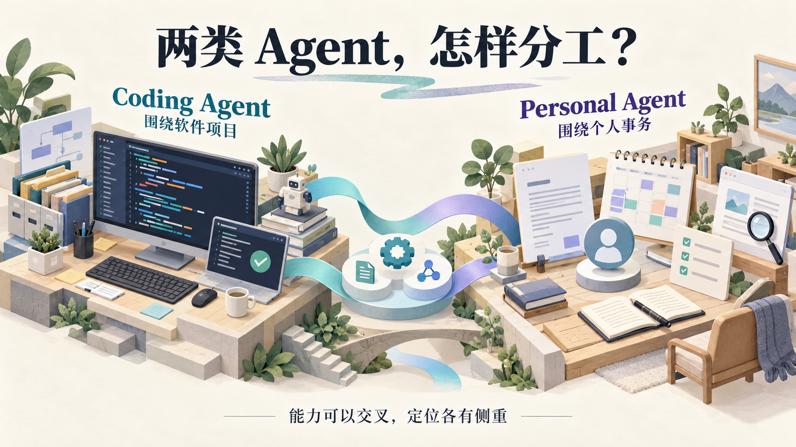
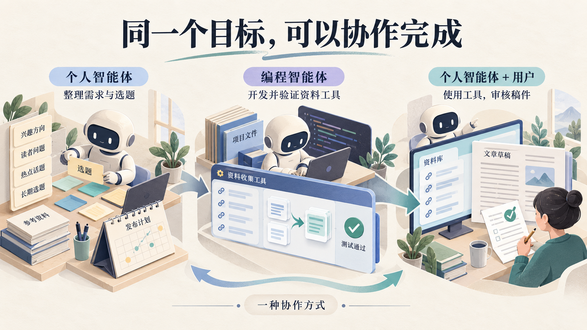
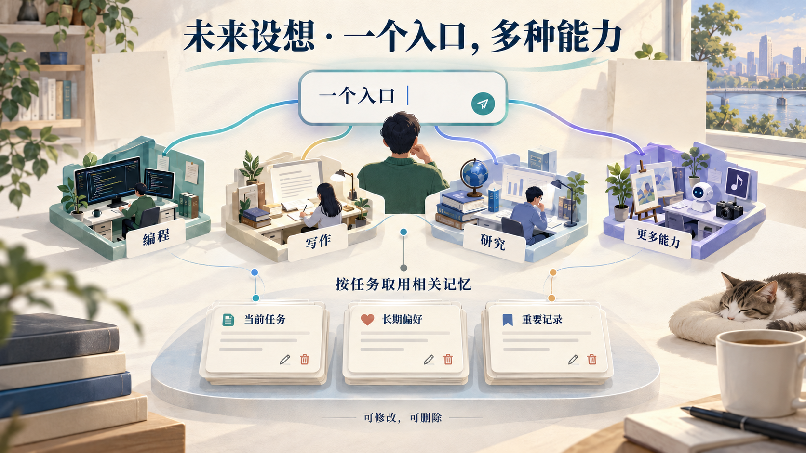

# Coding Agent 和 Personal Agent 有什么区别？从 Codex、dot 讲起

作者：司马简霖 · 首发日期：2026年10月17日

[微信公众号原文](https://mp.weixin.qq.com/s/GKCGtFNRL4mpNaXGGTS3CQ)

---

Codex 能写代码，也能帮人研究、写文章。dot 能处理个人事务，也能参与软件开发。两者都可以调用工具，为什么还要分成 Coding Agent 和 Personal Agent？

我把国内外厂商的官方介绍与产品文档对照了一遍，发现单看功能名单，很难理解这种区别。同样写着“搜索资料”“操作文件”“完成任务”，产品围绕什么目标组织工作，往往差得很远。

Coding Agent，也就是编程智能体，典型职责是把软件开发工作做完。Personal Agent 可以理解为个人智能体，围绕具体用户的情况，组织信息与行动，帮他把事务办成。“个人事务”也包括工作，例如经营一个微信公众号。

先把大模型与智能体的关系放清楚。

LLM 是 Large Language Model，即大语言模型。GPT、Claude、Gemini、Qwen 和 DeepSeek 都属于模型这一层。模型能够理解输入、推理、生成内容，也可以提出工具调用。

当你要求 AI 做一个软件，生成代码只是其中一步。项目文件要有人读取，程序需要实际运行，报错以后还要继续修改。模型需要结合工具与执行环境，才能参与这些行动。

Agent，中文通常称为智能体，负责把这些能力组织进任务过程。它根据目标选择行动，观察工具返回的结果，再调整下一步。同一款应用可以同时提供普通聊天、固定工作流程和 Agent 执行功能。[Anthropic 对 Agent 与工作流的说明](https://www.anthropic.com/research/building-effective-agents) [1]

<strong>用做公众号这件事，可以把两类 Agent 的工作过程看得更具体。</strong>

假设你经营一个 AI 科普公众号，希望减少收集资料的时间。下面是说明分工的设想，具体能完成哪些环节，取决于产品接入的工具与获得的授权。

你可以给 Coding Agent 这样一个任务。

> 帮我做一个选题资料工具，把指定网站上的 AI 产品更新收集起来，去掉重复内容，保留来源链接，生成一个可以查看的页面。

它需要先看已有项目，确定资料怎样获取和保存，再编写采集、去重和页面展示程序。代码写完以后，还要实际运行，查看结果是否符合要求。

如果同一条公告被收集两次，它需要检查去重逻辑，修改后重新运行。某个网站没有提供发布日期，也需要决定怎样处理缺失信息，并让页面正确显示。

交付时，你应该能看到项目文件、运行方式，以及相关验证结果。验收的重点是工具能不能用、功能是否符合需求、出现异常时有没有妥善处理。

<strong>这项任务围绕一个软件项目展开，交付物包括软件与验证结果。</strong>这也是 Codex、Claude Code 等编程产品重点支持的过程。Claude Code 的官方文档明确介绍了读取代码库、编辑文件、运行命令和连接开发工具等能力。[Claude Code 文档](https://code.claude.com/docs/en/overview) [2]

你也可以把另一种委托交给 Personal Agent。

> 帮我经营这个 AI 科普公众号。查看我过去的文章，每周准备几个合适的选题；我选定以后，你整理资料、准备初稿，发布前交给我审核。

这一次，它需要围绕你的写作事务组织工作。

它要了解读者是谁、你过去写过什么、最近确认了哪些方向。如果某个热点与你上周的文章高度重复，就需要调整角度，或者找一个更值得解释的问题。

你选定题目后，它继续收集和核对材料，准备稿件。你临时调整方向，它需要接着处理相关资料。文章还缺一份关键来源时，也应该让你知道问题在哪里，稿件推进到了哪一步。

你验收时，更关注选题是否适合自己的账号、资料是否可靠、稿件有没有按约定准备好，以及发布前是否经过了审核。

<strong>这份委托围绕你的写作事务展开，结果是写作计划得到实际推进。</strong>个人智能体也可以处理一次性任务；对于 dot 这类支持持续跟进的产品，还可以在两次对话之间检查进展，遇到变化后安排下一步。[dot 官方说明](https://learn.chatgpt.com/docs/dots) [3]

两类 Agent 使用的信息和工具，因而有所侧重。

| 比较角度 | Coding Agent 的典型重点 | Personal Agent 的典型重点 |
|---|---|---|
| 工作围绕什么展开 | 软件项目与开发需求 | 用户的目标与事务 |
| 经常需要了解什么 | 代码结构、项目规则、报错和测试结果 | 个人资料、偏好、历史决定和进度 |
| 常用工具 | 代码文件、终端、数据库、开发平台 | 文档、邮件、日历、浏览器与其他已授权工具 |
| 怎样验收 | 软件满足需求，并经过验证 | 事务办成，行动符合用户要求与授权 |

这些侧重点允许交叉。个人智能体发现你每周整理资料很费时间，可以把“开发资料工具”交给编程智能体。工具完成后，它再使用收集结果，继续筛选选题和准备稿件。dot 就支持把任务委托给 Codex，并检查结果、继续跟进。[dot 的任务协作说明](https://learn.chatgpt.com/docs/dots/tasks-and-memory) [4]

编程产品也可以处理研究和文档工作。Coding 强调专业任务，Personal 强调围绕具体用户组织服务，一个产品可以兼具这两种定位。判断产品定位，需要看它重点支持哪种工作过程，以及怎样组织工具和验收结果。

Always-on Agent 通常被称为常驻智能体，又多了一个观察角度。它强调系统可以在后台保持可用，按时间、事件或任务进展继续工作。系统可以暂停后再被唤醒，常驻服务并不要求每一秒都调用模型。

编程智能体同样可以在后台定期检查项目。Personal 描述围绕个人组织的服务，Always-on 描述运行方式，两者可以同时出现在一个产品身上。OpenAI 的 dot 就属于个人常驻方向。

概念分清以后，再看产品名单才有意义。以下根据截至 2026 年 10 月 15 日整理的官方资料介绍定位，覆盖代表性产品，也标明相邻的工作产品与执行框架。

Claude 的名称需要先说明。它既指 Anthropic 的模型家族，也指面向用户的应用。Claude Code 是具体的编程产品，Cowork 则覆盖研究、文件整理等知识工作。官方正在将 Cowork 与聊天整合进同一个 Claude 应用体验。[Claude 模型文档](https://platform.claude.com/docs/en/models/overview) [5]、[Claude 应用整合说明](https://support.claude.com/en/articles/16761823-claude-cowork-and-chat-are-one-claude) [6]

因此，比较 Claude 与 Codex 时，先确认自己比较的是模型、应用，还是具体的执行产品。

| 国际厂商或体系与模型 | 代表产品与定位 |
|---|---|
| OpenAI，GPT | 编程产品 [Codex](https://developers.openai.com/api/docs/guides/code-generation) [7]；个人常驻 [dot](https://learn.chatgpt.com/docs/dots) [3] |
| Anthropic，Claude | 编程产品 [Claude Code](https://code.claude.com/docs/en/overview) [2]；知识工作方向的 Cowork，正在整合进 Claude 应用 |
| Google，Gemini | 编程方向有 [Antigravity](https://antigravity.google/blog/introducing-google-antigravity-cli) [8]、[Gemini CLI](https://geminicli.com/docs/cli/tutorials/skills-getting-started/) [9] 和 [Jules](https://jules.google/docs/cli/reference/) [10]；个人常驻方向有 [Gemini Spark](https://blog.google/innovation-and-ai/products/gemini-app/next-evolution-gemini-app/) [11] |
| Grok 体系，Grok | 编程方向有 [Grok Build](https://x.ai/build) [12]；个人与团队常驻方向有 [Grok Bot](https://x.ai/bot) [13] |
| Amazon／AWS，Nova | 编程方向有 [Kiro](https://kiro.dev/docs/web/autonomous-mode/) [14]；家庭与生活助理方向有 [Alexa+](https://www.aboutamazon.com/news/devices/new-alexa-plus-amazon-devices) [15] |
| Mistral AI，Mistral 等模型 | [Vibe](https://docs.mistral.ai/vibe/overview) [16] 提供 Code 与 Work 模式，分别覆盖编程和知识工作 |
| 微软体系，Phi 等模型，其中 Phi 主要定位为小语言模型 | 编程方向有 [GitHub Copilot／Cloud Agent](https://docs.github.com/en/copilot/how-tos/copilot-on-github/use-copilot-agents/overview) [17]；广泛工作方向有 [Copilot Cowork](https://support.microsoft.com/en-us/microsoft-365-copilot/get-started-with-cowork) [18] |

Google 将 Gemini Spark 明确称为 24/7 个人智能体，Alexa+ 则更多围绕家庭与生活服务。Cowork、Vibe Work 这样的知识工作产品，与个人助理有任务上的重叠，具体服务范围仍应分别看。

Grok Bot 与 Grok Automations 也需要分开。Bot 是拥有云端电脑、能够持续工作的 Agent 产品。Automations 则是 Grok 应用中的自动化功能，可以按时间或收到的邮件触发工作，并保存执行记录。把应用功能单独列清楚，才能理解产品之间的关系。[Grok Automations 官方说明](https://x.ai/news/grok-automations) [19]

国际模型市场还包括 Meta 的 [Llama](https://ai.meta.com/llama/get-started/) [20]、Cohere 的 [Command](https://docs.cohere.com/v1/docs/models) [21] 和 IBM 的 [Granite](https://www.ibm.com/granite) [22]。微软的 [Phi](https://github.com/microsoft/PhiCookBook/blob/main/md/01.Introduction/01/01.PhiFamily.md) [23] 有自己的模型定位，也不能由此推断 Copilot 只使用 Phi。

国内同样需要把模型、执行产品和服务方式分别看。

| 国内厂商与模型 | 代表产品与定位 |
|---|---|
| 阿里／Qwen，通义千问 | 编程方向有 [Qwen Code](https://qwenlm.github.io/qwen-code-docs/en/users/overview/) [24]；个人助理方向有 [QwenPaw](https://help.aliyun.com/zh/model-studio/qwenpaw) [25]，原名 CoPaw |
| 百度，ERNIE／文心 | 编程方向有 [Comate／Zulu](https://comate.baidu.com/docs/vscode.html) [26]；云端个人助理方向有 [DuClaw](https://cloud.baidu.com/product/du.html) [27] |
| 腾讯，混元 | 编程方向有 [CodeBuddy](https://www.codebuddy.cn/downloads/) [28]；本地电脑助理有 [QClaw](https://intl.cloud.tencent.com/zh/document/product/1300/81043) [29]，办公任务产品有 [WorkBuddy](https://cloud.tencent.com/product/workbuddy) [30] |
| 字节跳动，豆包 | 编程方向有 [TRAE／SOLO](https://docs.trae.cn/ide_solo-mode) [31]；[扣子](https://www.coze.cn/overview) [32] 覆盖工作助理与智能体搭建平台 |
| 智谱／Z.ai，GLM | 编程方向有 [ZCode](https://zcode.z.ai/en/docs/agents) [33]；本地工作助理有 [AutoClaw](https://autoclaw.zhipuai.cn/) [34] |
| 月之暗面，Kimi | 编程方向有 [Kimi Code](https://www.kimi.com/code/docs/en/kimi-code-cli/guides/getting-started.html) [35]；个人助理方向有 [Kimi Claw](https://www.kimi.com/en/help/kimi-claw/overview) [36] |
| MiniMax，M 系列模型 | 编程方向有 [MiniMax Code](https://agent.minimax.io/tools/ai-coding-agent) [37]；云端个人助理方向有 [MaxClaw](https://agent.minimax.io/activity/max-claw) [38] |
| 阶跃星辰，Step | 编程方向有 [Step Code](https://platform.stepfun.com/step-code) [39]，官方将其称为编程 Harness |
| DeepSeek，DeepSeek | 提供 [DeepSeek Harness](https://api-docs.deepseek.com/) [40]，处于开发者预览阶段，也支持模型接入第三方 Agent 工具 |

Harness 指承载 Agent 执行的程序，处理工具、上下文和任务运行等环节。面向开发者的框架与普通用户直接使用的应用，在部署和交互上会有差别。

国内的个人助理也有不同的实现。QwenPaw 由 AgentScope 团队开发，支持本地或云端部署。Kimi Claw 提供云端 OpenClaw 部署，也能连接用户已有的 OpenClaw。MaxClaw 则提供云端托管方式。名称接近的产品，使用方式可能差很多。

国内模型家族还包括 [讯飞星火](https://xinghuo.xfyun.cn/sparkapi) [41]、[华为盘古](https://www.huaweicloud.com/product/pangu/nlp.html) [42] 和 [商汤日日新 SenseNova](https://largemodel.sensetime.com/) [43]。表中没有列出一一对应的个人助理，不表示厂商没有相关能力。

<strong>这些表格按厂商归属整理，不代表 Agent 只能使用同一行的模型。</strong>

DeepSeek 官方文档就列出了与 Claude Code、Codex、OpenCode、OpenClaw 等工具配合的方法。模型与执行产品可以交叉组合，选模型和选 Agent，因而需要分别判断。[DeepSeek 接入文档](https://api-docs.deepseek.com/) [40]

专业产品与开源项目也值得补进来，否则会漏掉市场中的大量选择。

编程方向还有 [Cursor](https://cursor.com/docs/cloud-agent) [44]、[Devin](https://devin.ai/) [45]、[Auggie](https://www.augmentcode.com/product/cli) [46]、[Junie](https://www.jetbrains.com/help/ai-assistant/junie-agent.html) [47]、[Amp](https://ampcode.com/docs) [48]、[Qoder](https://qoder.com/download) [49] 和 [Zed Agent](https://zed.dev/docs/ai/zed-agent) [50]。开发者可以配置的工具与框架包括 [Cline](https://docs.cline.bot/cline-overview) [51]、[OpenCode](https://docs.opencode.ai/docs/) [52]、[Kilo Code](https://kilo.ai/docs/getting-started) [53]、[Continue](https://docs.continue.dev/cli/quickstart) [54] 和 [OpenHands](https://www.openhands.dev/product) [55]。

团队执行与编排方向还有 [GitLab Duo Agent Platform](https://docs.gitlab.com/user/get_started/get_started_agent_platform/) [56] 和 [Warp Oz](https://www.warp.dev/blog/oz-orchestration-platform-cloud-agents) [57]。如果希望从自然语言直接构建应用，可以看到 [Replit Agent](https://docs.replit.com/references/agent/overview) [58]、[v0](https://v0.app/docs) [59]、[Lovable](https://lovable.dev/build/app-builder) [60] 和 [Bolt](https://bolt.new/) [61]。它们与代码库开发工具共享部分能力，面向用户的交互有所不同。

个人助理方向有 [Poke](https://cognition.com/blog/interaction) [62]、[Lindy Assistant](https://www.lindy.ai/blog/lindy-assistant-launch) [63] 和 [Martin](https://www.trymartin.com/) [64]。[Slackbot](https://slack.com/resources/using-slack/what-is-slackbot) [65] 被官方定位为服务工作场景的个人 AI Agent，围绕 Slack 中可访问的信息提供帮助。个人助理处理的事务，可以来自工作环境。

Genspark 同时提供几种形态。[GenCode](https://www.genspark.ai/helpcenter/gencode) [66] 是在代码目录中工作的编程智能体，[Genspark Code](https://www.genspark.ai/helpcenter/ai-developer) [67] 是浏览器中的应用构建产品，[Genspark Claw](https://www.genspark.ai/claw/intro) [68] 则定位为拥有云端电脑的个人助理。三个名字需要分别看。

广泛处理知识工作的产品还有 [Manus](https://www.manus.im/features/automations) [69]、[Perplexity Computer](https://www.perplexity.ai/products/computer) [70] 和 [QoderWork](https://docs.qoder.com/qoderwork/introduction) [71]。希望自行部署助理的用户，则可以关注 [OpenClaw](https://docs.openclaw.ai/concepts/main-session) [72]、[Hermes Agent](https://hermes-agent.nousresearch.com/docs/user-guide/features/cron/) [73]、[nanobot](https://github.com/HKUDS/nanobot/blob/main/docs/guides/build-a-personal-ai-agent.md) [74] 和 [NanoClaw](https://nanoclaw.dev/) [75]。

把国内外产品放在一起，比较的重点应该落到同一个实际任务。

对编程产品，可以使用同一代码库和同一需求，检查跨文件修改、运行验证和异常处理。模型的代码生成表现，只能解释其中一部分结果，执行工具与任务管理也会影响交付。

个人助理则需要结合你的日常工具。dot 可以通过 ChatGPT、Slack 或 Teams 联系用户，Gemini Spark 连接 Google Workspace 工具，QClaw 强调微信直连，Kimi Claw 支持配置微信、飞书和企业微信等渠道。入口影响你怎样交代任务，也影响系统能获得哪些背景资料。

还要看任务运行在哪里。Grok Bot 的云端任务可以在用户关闭电脑后继续。Perplexity Personal Computer 使用本地 Mac 的应用和文件时，需要相应设备保持运行，官方以持续在线的 Mac mini 举例。[Perplexity Personal Computer 官方说明](https://www.perplexity.ai/ml/hub/academy/personal-computer-for-mac) [76]

dot 访问连接电脑上的本地文件与应用时，也要求电脑在线，并打开 ChatGPT 应用。一个系统可以提供常驻服务，但具体任务仍然受执行环境影响。[dot 的电脑连接说明](https://learn.chatgpt.com/docs/dots) [3]

回到公众号的例子，软件工具要验收功能与运行结果，个人助理要观察选题和稿件是否按要求推进。单看一次回答，难以判断它能否在后续变化中继续把事情办好。

这些交叉也让我倾向于一个判断，<strong>普通用户面对的 AI 入口会逐渐统一。</strong>

用户直接交代目标，系统在任务推进中安排合适的专业能力。Claude 正整合聊天与 Cowork，Mistral Vibe 提供 Work 和 Code 模式，dot 可以委托 Codex，已经展示了不同的整合方式。最终的产品名称与内部架构，仍然有待观察。[Claude 应用整合说明](https://support.claude.com/en/articles/16761823-claude-cowork-and-chat-are-one-claude) [6]、[Vibe 文档](https://docs.mistral.ai/vibe/overview) [16]

专业工作环境仍有保留的理由。开发者需要检查代码修改，用户需要审核准备发布的文章。统一入口可以减少用户在任务开始前的选择，执行过程仍然应该可以检查和干预。

记忆也会遇到类似的问题。我设想，多数执行依赖当前任务的短期上下文，稳定的个人偏好与跨任务决定需要更长时间保留。这些信息可以服务写作和开发等不同任务，具体取用哪些内容，应当根据任务判断。少量重要记录可以设置为不自动过期，也就是一种“永久记忆”，同时保留修改、删除和标记失效的能力。旧决定需要检查是否仍然适用。

这属于产品设计的推演。目前不同产品的记忆仍可能分别管理。OpenAI 官方文档就区分了 ChatGPT 记忆与本地 Codex 的记忆存储及控制方式。入口整合与记忆互通，需要分别观察。[OpenAI 记忆说明](https://learn.chatgpt.com/docs/customization/memories) [77]

当一个入口能够调动多种专业能力，用户交给它的究竟是一项任务，还是一项持续责任？哪部分记忆应该跨任务使用，遇到什么变化它应该主动行动，事情做完以后又由谁验收？这些问题，留到第二篇继续讨论。

## 资料来源

以下为正文引用的官方资料与项目文档。外站网址可复制到浏览器打开。

[1] Anthropic 对 Agent 与工作流的说明  
<https://www.anthropic.com/research/building-effective-agents>

[2] Claude Code 文档  
<https://code.claude.com/docs/en/overview>

[3] dot 官方说明  
<https://learn.chatgpt.com/docs/dots>

[4] dot 的任务协作说明  
<https://learn.chatgpt.com/docs/dots/tasks-and-memory>

[5] Claude 模型文档  
<https://platform.claude.com/docs/en/models/overview>

[6] Claude 应用整合说明  
<https://support.claude.com/en/articles/16761823-claude-cowork-and-chat-are-one-claude>

[7] Codex  
<https://developers.openai.com/api/docs/guides/code-generation>

[8] Antigravity  
<https://antigravity.google/blog/introducing-google-antigravity-cli>

[9] Gemini CLI  
<https://geminicli.com/docs/cli/tutorials/skills-getting-started/>

[10] Jules  
<https://jules.google/docs/cli/reference/>

[11] Gemini Spark  
<https://blog.google/innovation-and-ai/products/gemini-app/next-evolution-gemini-app/>

[12] Grok Build  
<https://x.ai/build>

[13] Grok Bot  
<https://x.ai/bot>

[14] Kiro  
<https://kiro.dev/docs/web/autonomous-mode/>

[15] Alexa+  
<https://www.aboutamazon.com/news/devices/new-alexa-plus-amazon-devices>

[16] Vibe  
<https://docs.mistral.ai/vibe/overview>

[17] GitHub Copilot／Cloud Agent  
<https://docs.github.com/en/copilot/how-tos/copilot-on-github/use-copilot-agents/overview>

[18] Copilot Cowork  
<https://support.microsoft.com/en-us/microsoft-365-copilot/get-started-with-cowork>

[19] Grok Automations 官方说明  
<https://x.ai/news/grok-automations>

[20] Llama  
<https://ai.meta.com/llama/get-started/>

[21] Command  
<https://docs.cohere.com/v1/docs/models>

[22] Granite  
<https://www.ibm.com/granite>

[23] Phi  
<https://github.com/microsoft/PhiCookBook/blob/main/md/01.Introduction/01/01.PhiFamily.md>

[24] Qwen Code  
<https://qwenlm.github.io/qwen-code-docs/en/users/overview/>

[25] QwenPaw  
<https://help.aliyun.com/zh/model-studio/qwenpaw>

[26] Comate／Zulu  
<https://comate.baidu.com/docs/vscode.html>

[27] DuClaw  
<https://cloud.baidu.com/product/du.html>

[28] CodeBuddy  
<https://www.codebuddy.cn/downloads/>

[29] QClaw  
<https://intl.cloud.tencent.com/zh/document/product/1300/81043>

[30] WorkBuddy  
<https://cloud.tencent.com/product/workbuddy>

[31] TRAE／SOLO  
<https://docs.trae.cn/ide_solo-mode>

[32] 扣子  
<https://www.coze.cn/overview>

[33] ZCode  
<https://zcode.z.ai/en/docs/agents>

[34] AutoClaw  
<https://autoclaw.zhipuai.cn/>

[35] Kimi Code  
<https://www.kimi.com/code/docs/en/kimi-code-cli/guides/getting-started.html>

[36] Kimi Claw  
<https://www.kimi.com/en/help/kimi-claw/overview>

[37] MiniMax Code  
<https://agent.minimax.io/tools/ai-coding-agent>

[38] MaxClaw  
<https://agent.minimax.io/activity/max-claw>

[39] Step Code  
<https://platform.stepfun.com/step-code>

[40] DeepSeek Harness  
<https://api-docs.deepseek.com/>

[41] 讯飞星火  
<https://xinghuo.xfyun.cn/sparkapi>

[42] 华为盘古  
<https://www.huaweicloud.com/product/pangu/nlp.html>

[43] 商汤日日新 SenseNova  
<https://largemodel.sensetime.com/>

[44] Cursor  
<https://cursor.com/docs/cloud-agent>

[45] Devin  
<https://devin.ai/>

[46] Auggie  
<https://www.augmentcode.com/product/cli>

[47] Junie  
<https://www.jetbrains.com/help/ai-assistant/junie-agent.html>

[48] Amp  
<https://ampcode.com/docs>

[49] Qoder  
<https://qoder.com/download>

[50] Zed Agent  
<https://zed.dev/docs/ai/zed-agent>

[51] Cline  
<https://docs.cline.bot/cline-overview>

[52] OpenCode  
<https://docs.opencode.ai/docs/>

[53] Kilo Code  
<https://kilo.ai/docs/getting-started>

[54] Continue  
<https://docs.continue.dev/cli/quickstart>

[55] OpenHands  
<https://www.openhands.dev/product>

[56] GitLab Duo Agent Platform  
<https://docs.gitlab.com/user/get_started/get_started_agent_platform/>

[57] Warp Oz  
<https://www.warp.dev/blog/oz-orchestration-platform-cloud-agents>

[58] Replit Agent  
<https://docs.replit.com/references/agent/overview>

[59] v0  
<https://v0.app/docs>

[60] Lovable  
<https://lovable.dev/build/app-builder>

[61] Bolt  
<https://bolt.new/>

[62] Poke  
<https://cognition.com/blog/interaction>

[63] Lindy Assistant  
<https://www.lindy.ai/blog/lindy-assistant-launch>

[64] Martin  
<https://www.trymartin.com/>

[65] Slackbot  
<https://slack.com/resources/using-slack/what-is-slackbot>

[66] GenCode  
<https://www.genspark.ai/helpcenter/gencode>

[67] Genspark Code  
<https://www.genspark.ai/helpcenter/ai-developer>

[68] Genspark Claw  
<https://www.genspark.ai/claw/intro>

[69] Manus  
<https://www.manus.im/features/automations>

[70] Perplexity Computer  
<https://www.perplexity.ai/products/computer>

[71] QoderWork  
<https://docs.qoder.com/qoderwork/introduction>

[72] OpenClaw  
<https://docs.openclaw.ai/concepts/main-session>

[73] Hermes Agent  
<https://hermes-agent.nousresearch.com/docs/user-guide/features/cron/>

[74] nanobot  
<https://github.com/HKUDS/nanobot/blob/main/docs/guides/build-a-personal-ai-agent.md>

[75] NanoClaw  
<https://nanoclaw.dev/>

[76] Perplexity Personal Computer 官方说明  
<https://www.perplexity.ai/ml/hub/academy/personal-computer-for-mac>

[77] OpenAI 记忆说明  
<https://learn.chatgpt.com/docs/customization/memories>
